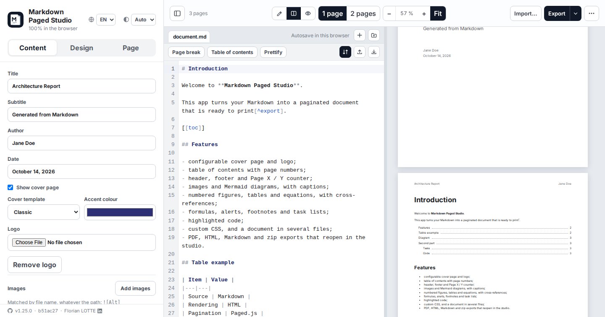
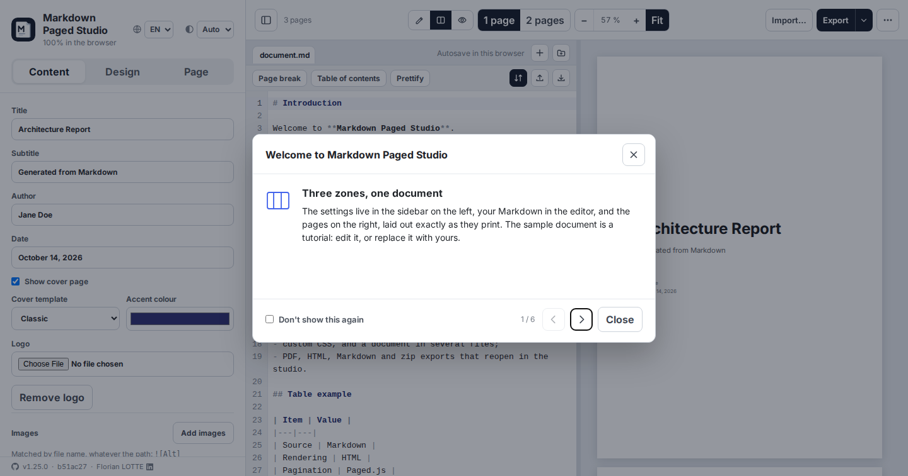
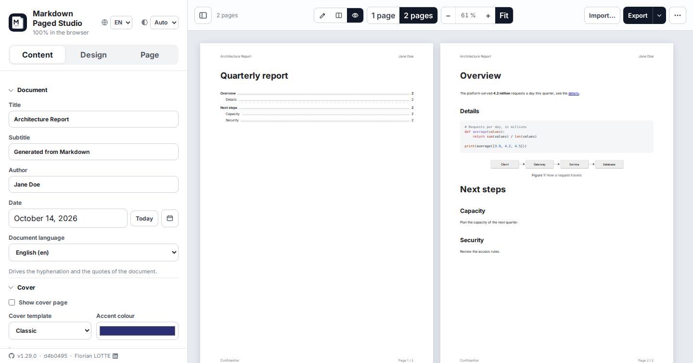
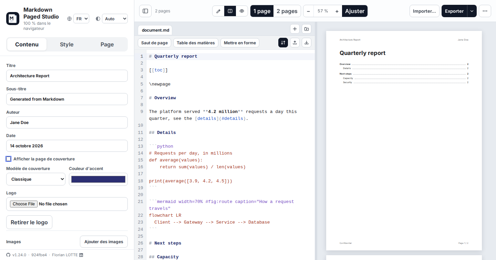
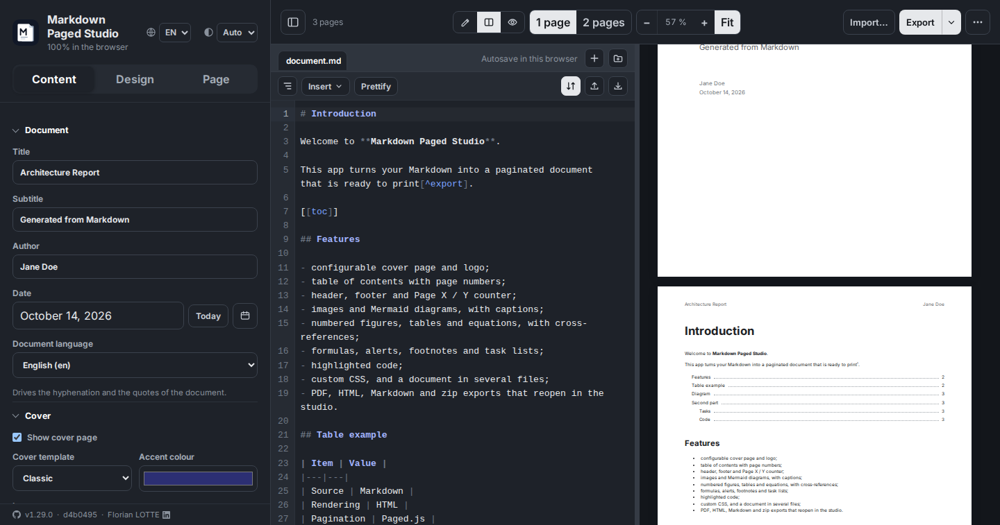

<p align="center">
  
</p>

<h1 align="center">Markdown Paged Studio</h1>

<p align="center">
  Write Markdown, add your own CSS, and get a paginated, print-ready document with a cover page, a table of contents, headers, footers, page numbers and Mermaid diagrams.<br />
  Everything runs in the browser. No backend, no account, no tracking.
</p>

<p align="center">
  <a href="https://github.com/florianlotte/markdown-paged-studio/actions/workflows/ci.yml"></a>
  
  
  
  
  
  <a href="https://github.com/florianlotte/markdown-paged-studio/releases/latest"></a>
  <a href="https://github.com/sponsors/florianlotte"></a>
</p>

**Try it online: [florianlotte.github.io/markdown-paged-studio](https://florianlotte.github.io/markdown-paged-studio/)** (deployed from `main` by GitHub Actions; your documents stay in your browser).



## Features

- **Live paged preview** powered by [Paged.js](https://pagedjs.org): what you see is what prints.
- **Bundled font**: Inter ships with the studio and is embedded in every export, so the preview, the print and the PDF look the same on any machine.
- **Cover page** with title, subtitle, author, date and an optional logo, in four templates with an accent colour.
- **Table of contents** with page numbers from `[[toc]]`, **page breaks** from `\newpage`, **footnotes** at the foot of the page, and an anchor on every heading for `[links](#heading)`.
- **Running header** (left and right, or the current chapter), **footer**, and an automatic `Page X / Y` counter.
- **A4, Letter or A5** with configurable margins, mirrored on facing pages if you print double-sided.
- **Syntax highlighting** of code blocks, light or dark, and **captions** under images and diagrams.
- **Mermaid diagrams** from ` ```mermaid ` code fences, rendered to SVG and embedded in exports, resizable by dragging in the preview.
- **Document language** (BCP 47 tag) driving hyphenation, typographic quotes (« » in French, „ “ in German…), the titles of alerts and the words of the numbering.
- **Images** uploaded, dropped or pasted, matched to the Markdown by file name, resizable like the diagrams.
- **Custom CSS** editor with import, applied to the document only.
- **Interface in English or French**, and a **light or dark theme** for the studio, each following the system or your choice; the pages stay white.
- **Automatic numbering and cross-references**: headings, figures, tables and equations are numbered for you, and `@fig:plan` in the text becomes "figure 3", with a link, wherever the figure ends up.
- **Formulas, alerts and more**: TeX formulas drawn by KaTeX (`$E = mc^2$`), GitHub alerts (`> [!NOTE]`), highlighted text, subscript, superscript and definition lists.
- **A document in several files**: chapters as tabs above the editor, assembled into one paged document and one PDF, with shared settings, table of contents and page numbers.
- **A real editor**: Markdown colours, line numbers, search and replace (Ctrl+F), **Prettify** to format the file the way Prettier does, and the preview scrolling along with the text; a double-click in the preview shows the source.
- **Edit, Split or View**: the editor and the paged preview share the window with a draggable splitter, or one of them takes it all; plus one page or two pages side by side, zoom, fit to width, Ctrl + wheel, and a collapsible settings sidebar.
- **Autosave** in the browser, plus export and import of the whole configuration as JSON.
- **Personal defaults** (your name, company logo, stylesheet, template) from a gitignored `local/` folder.
- **Export menu**: PDF with project, PDF only, HTML with project (a standalone page that paginates offline), Markdown with project (a `.md` whose YAML front matter holds the settings and images), Markdown files (a zip of the files, the stylesheet and the images side by side) or the project alone. In the browser the studio draws the PDF with project itself and the PDF only goes through the print dialog; the desktop app writes both directly.
- **Editable exports**: the HTML export, the Markdown export, the zip of files and the PDF with project carry the document, its settings and its images, and **Import…** reopens them, as well as a plain `.md` file or any zip of Markdown files.
- **Desktop app** for Windows (x64 and ARM64), Linux and macOS (Apple Silicon and Intel), portable, no installation.
- **MCP server** so a local AI assistant can generate reports through the same rendering pipeline.
- **Static build** you can host anywhere: GitHub Pages, Netlify, Cloudflare Pages, nginx, or the provided Docker image.

## Quick start

```bash
npm install
npm run dev
```

Open the URL Vite prints. To ship it:

```bash
npm run build     # static site in dist/
npm run preview   # serve dist/ locally to check the build
```

Node.js 20.19+ or 22.12+ is required by Vite 8.

## Usage

The Markdown editor sits beside the paged preview (**Split**) or alone (**Edit**); **View** shows the preview alone. The **Insert** menu above the editor writes an example of a table, an image, a diagram, a formula, an alert, a footnote, a page break or a table of contents at the cursor (an empty file says so); the bar also formats the file (**Prettify**), replaces or downloads it, and switches the scroll synchronisation; the row of the file tabs says when the document was last saved in the browser. A right-click on a file tab (a long press, or Shift+F10) offers Rename, Move, Download and Remove. The sidebar holds the settings in groups that fold: **Content** (the document fields with a date picker and the language chosen by name, the cover with a drop zone for the logo, the images with their count), **Design** (headers and footers, numbering, code theme and stylesheet) and **Page** (paper size, margins with presets and "same on all sides"). The ⋯ menu of the toolbar shows the welcome tour again (six panels on how the studio works, opened on the first visit until you tick "Don't show this again"), lists the keyboard shortcuts (also `?`) and resets the document, with ten seconds to undo. The [writing guide](docs/writing.md) describes everything you can write:



- [Several files](docs/writing.md#several-files): chapters as tabs, one paged document.
- [Diagrams](docs/writing.md#diagrams): Mermaid fences, sized and aligned from the preview.
- [Formulas, alerts and more](docs/writing.md#formulas-alerts-and-more): TeX with KaTeX, GitHub alerts, highlighted text, subscript and superscript, definition lists.
- [Numbering and cross-references](docs/writing.md#numbering-and-cross-references): `{#fig:plan}` and `@fig:plan` for figures, tables, equations and headings.
- [Structure](docs/writing.md#structure-table-of-contents-page-breaks-footnotes-code): table of contents, page breaks, footnotes, task lists, highlighted code, heading anchors.
- [Images](docs/writing.md#images): matched by file name, sized in braces or from the preview, captioned.
- [Cover page, header and footer](docs/writing.md#cover-page-header-and-footer) and [Page setup](docs/writing.md#page-setup).

[Markdown support](docs/markdown-support.md) lists what the parser understands, its four deliberate differences with CommonMark, and the conformance measured on the official examples.

### Custom CSS

The **Design** tab has a CSS editor. Its content is appended after the built-in styles, so your rules win on equal specificity. The colours of the code theme are the exception: choose **None** as code highlighting to style the code blocks yourself. The structure and the class names below are the contract of the document, kept in `docs/css-contract.md` and also served to AI assistants by the MCP server:

<!-- css-contract:start -->

The rendered document has this structure (the cover section only when the cover page is on):

```html
<section class="cover-page">
  
  <h1 class="cover-title">…</h1>
  <div class="cover-subtitle">…</div>
  <div class="cover-meta">
    <div>author</div>
    <div>date</div>
  </div>
</section>
<article class="document-content">…your Markdown as HTML…</article>
```

Inside the content, these class names are stable and meant to be styled:

| Element           | Selector                                                                                                                                                                                                                                                                                     |
| ----------------- | -------------------------------------------------------------------------------------------------------------------------------------------------------------------------------------------------------------------------------------------------------------------------------------------- |
| Diagram           | `.mermaid-diagram`, its drawing `.mermaid-diagram > svg`; `.is-sized` with `--diagram-width`, `data-align`; a failed one keeps the wrapper and holds a `pre.mermaid-error`                                                                                                                   |
| Image             | `.document-image` around the `img`; `.is-block` alone in a paragraph, `.is-sized` with `--image-width`, `data-align`, `.has-caption` with a caption; `.image-missing` if not uploaded                                                                                                        |
| Number, reference | `.heading-number` in a numbered heading ("1.1.", with a right margin), `.caption-label` opening a numbered caption ("Figure 1: "), `.ref` (a link) with `.ref-fig`, `.ref-tab`, `.ref-eq` or `.ref-sec`, a `span.ref.ref-missing` for an unknown label; ids start with `fig-`, `tab-`, `eq-` |
| Table caption     | `caption.table-caption` inside a `table.has-caption`                                                                                                                                                                                                                                         |
| Caption           | `.image-caption`, `.diagram-caption`                                                                                                                                                                                                                                                         |
| Table of contents | `nav.toc` holding an `ol.toc-list` of `.toc-item` with `.toc-level-1`…, holding a link with `.toc-text` and `.toc-dots`; the page number is the `::after` of the link                                                                                                                        |
| Page break        | `.page-break`                                                                                                                                                                                                                                                                                |
| Footnote          | `.footnote` for the note, `.footnote::footnote-call` for its call in the text, `.footnote::footnote-marker` for its number, `.footnote-ref` for a repeated call; the area of the notes is `@page { @footnote { … } }`                                                                        |
| Task list         | `.contains-task-list` on the list, `.task-list-item` on the item, holding an `input`                                                                                                                                                                                                         |
| Formula           | `.math` with `.math-inline` or `.math-block`, holding KaTeX's `.katex`; `.math-error` when the formula could not be read                                                                                                                                                                     |
| Alert             | `.alert` with `.alert-note`, `.alert-tip`, `.alert-important`, `.alert-warning` or `.alert-caution`, its title in `.alert-title`; the colour is `--alert-color`                                                                                                                              |
| Highlighted text  | `mark`; subscript and superscript are `sub` and `sup`, definition lists `dl`, `dt`, `dd`                                                                                                                                                                                                     |
| Highlighted code  | `pre.code-block` with `.code-light` or `.code-dark`, and highlight.js `.hljs-*` spans                                                                                                                                                                                                        |
| Heading           | an `id` made of `sec-` and the anchor name: `#sec-details`                                                                                                                                                                                                                                   |

Header, footer and the page counter are `@page` margin boxes driven by the settings, not by classes. Use print units (`mm`, `pt`) and paged-media properties such as `break-before: page` or `break-inside: avoid`.

<!-- css-contract:end -->

A minimal example:

```css
.document-content {
  font-family: Georgia, serif;
  font-size: 11pt;
}
.document-content h2 {
  break-before: page;
}
.cover-title {
  color: #2c2f73;
}
```

**Default CSS** restores the default stylesheet.

### Preview controls

| Control                                  | Effect                                                                                                                                                                                                                    |
| ---------------------------------------- | ------------------------------------------------------------------------------------------------------------------------------------------------------------------------------------------------------------------------- |
| **Edit** / **Split** / **View**          | The editor alone, both side by side, or the preview alone: Ctrl+Shift+1/2/3 (Cmd+Alt+1/2/3 on macOS), in the desktop app also the **View** menu (Edit, Side by side, Preview). On phones Split gives way to Edit and View |
| **Scroll together** (bar of the editor)  | The pane you scroll takes the other one along; switch it off to read one part while writing another                                                                                                                       |
| **Splitter** between editor and preview  | Drag to share the width (20 to 80 %); arrow keys move it by 2 %, Home and End to the ends, a double-click resets the half                                                                                                 |
| **1 page** / **2 pages**                 | One continuous column, or two pages side by side                                                                                                                                                                          |
| **−** / **+**                            | Zoom out or in by 10 %, between 25 % and 300 %                                                                                                                                                                            |
| **Fit**                                  | Fit the page (or the pair of pages) to the available width, and keep following window resizes                                                                                                                             |
| **Ctrl + wheel** (Cmd on macOS)          | Zoom with the mouse over the preview                                                                                                                                                                                      |
| **Sidebar toggle** (left of the toolbar) | Hide or show the settings sidebar to give the preview the full width: Ctrl+B, in the desktop app also **View → Toggle Sidebar**                                                                                           |
| **Keyboard shortcuts**                   | `?` outside a text field, the ⋯ menu, or **Help → Keyboard Shortcuts** in the desktop app: the panel lists every shortcut; the tooltips, shown on hover and on keyboard focus, carry the shortcut of their control        |
| **Links** of the document                | Open in a new tab (the system browser in the desktop app), so the studio stays in place                                                                                                                                   |



View mode, editor width, scroll synchronisation, layout, zoom and the sidebar state are remembered in the browser, separately from the document.

The footer of the sidebar shows which build is running, for example `v1.13.1 · 2205ce9`: the version links to its release notes and the commit to the exact source. It tells apart two deployments of the online demo made between two releases. The GitHub mark in front of it leads to the repository, and the author's name next to it to his LinkedIn profile.

### Interface language

The studio speaks English and French. It follows the language of the browser and the selector at the top of the sidebar, next to the logo, changes it; the choice is remembered on that device. It is a setting of the studio, not of the document: the language of the document, which drives hyphenation and quotes, is chosen by name in the **Content** tab (or typed as a BCP 47 tag under "Other…").



### Theme

The studio follows the light or dark theme of the system, and the selector next to the language, at the top of the sidebar, forces one or the other (**Auto**, **Light**, **Dark**; on desktop also View → Theme). The choice is remembered on that device, apart from the document. Only the chrome changes: the pages of the preview are shown as they print, white in both themes, and the exports are identical.



### Personal defaults

Your own name, company logo, stylesheet or document template can be the defaults of every session, from the gitignored `local/` folder: see [local/README.md](local/README.md).

### Saving and exports

The document autosaves in the browser, and the row of the file tabs says when ("Saved in this browser · just now"); **Reset the document** (⋯ menu) restores the sample, and its toast undoes that for ten seconds. **Export** (Ctrl+Shift+E) writes the PDF with the project, drawn by the browser itself, or directly by the desktop app and the MCP server; its menu offers PDF only (through the print dialog), HTML with project, Markdown with project, Markdown files (zip) and Project only. Every export but the project file is named after the title. The HTML, Markdown, zip and PDF with project carry the document, its settings and its images, and **Import…** reopens them, as well as a plain `.md` file or any zip of Markdown files. What each format holds, and how an export reopens: [Saving and exporting](docs/exports.md).

## How it works

markdown-it turns the Markdown into HTML, Mermaid and highlight.js enrich it on demand, `documentCss()` builds the `@page` rules and appends your CSS, and Paged.js lays the pages out in a hidden stage before they are swapped into the preview; the exports inline the same Paged.js build, so both always match. The pipeline, the layout of the project and the workflows are described in [docs/architecture.md](docs/architecture.md).

## Desktop app

The same application ships as a portable desktop app built with Electron, with Chromium embedded so the preview and the PDF output are identical on every platform. Binaries are attached to each [GitHub Release](https://github.com/florianlotte/markdown-paged-studio/releases):

| System  | Files                                     | Notes                                                                                                                               |
| ------- | ----------------------------------------- | ----------------------------------------------------------------------------------------------------------------------------------- |
| Windows | portable `.exe` and `.zip`, x64 and ARM64 | No installation. The `.zip` holds the same app for company PCs that block downloaded executables: unzip, then run the `.exe` inside |
| Linux   | `AppImage`, x86_64                        | Make it executable, then run it                                                                                                     |
| macOS   | `dmg` and `zip`, Apple Silicon and Intel  |                                                                                                                                     |

The portable Windows executable keeps the saved document and the view settings in a `markdown-paged-studio-data` folder next to it. Each release also carries `SHA256SUMS-<os>.txt` files to verify the downloads. The binaries are not code-signed, so Windows SmartScreen and macOS Gatekeeper will ask for confirmation on first launch.

In the desktop app, the PDF exports write the file directly through the embedded Chromium engine instead of going through a print dialog, and **File → Print…** (Ctrl+P) prints on paper. Links of the document open in the system browser. Everything else works exactly as in the browser, including the personal defaults from `local/` baked in at build time. The entries of the application menu that belong to the studio are in French on a French system; the standard Edit and Window menus come from Electron, in English.

Building and testing the desktop app from the sources, and publishing a release: [CONTRIBUTING.md](CONTRIBUTING.md#desktop-app).

## MCP server for AI assistants

`mcp/server.mjs` is a [Model Context Protocol](https://modelcontextprotocol.io) server (stdio) that lets a local AI assistant generate reports with the real rendering pipeline: `render_pdf`, `render_html` and `describe_config`, plus a resource documenting the CSS contract. It takes one Markdown text and the settings of the document, with the syntax of the editor (diagrams, images by file name, formulas, alerts, numbering, table of contents, page breaks); Prettify and the preview tools belong to the studio only. Setup, tool inputs and safety options: [mcp/README.md](mcp/README.md).

## Docker

The image builds the static site and serves it with nginx. No runtime configuration is needed.

```bash
docker compose up --build -d   # then open http://localhost:8080
```

Or without Compose:

```bash
docker build --build-arg APP_COMMIT=$(git rev-parse --short=7 HEAD) -t markdown-paged-studio .
docker run --rm -p 8080:80 markdown-paged-studio
```

`APP_COMMIT` is optional: the image has no git history, so without it the sidebar footer shows the version only.

The build context includes the gitignored `local/` folder, so an image built on your machine carries your personal defaults. Keep such images private, or build from a clean checkout for a public image.

## Development

The scripts, the rules of the code base and the release procedure are in [CONTRIBUTING.md](CONTRIBUTING.md); the rendering pipeline, the layout of the project and the workflows in [docs/architecture.md](docs/architecture.md). In short: `npm run dev`, `npm test` (web tests under Chromium; `PORT=5183 npm test` if port 5173 is busy), `npm run test:unit`, `npm run lint`.

## Browser support

Recent Chromium-based browsers (Chrome, Edge, Brave, Arc) are the reference for both the preview and printing. On phones and narrow windows the settings open as a full-screen drawer over the preview, and the toolbar actions scroll horizontally. Firefox 126+ and Safari 17+ have what the studio relies on (the CSS `zoom` property for the preview zoom, among others), and the automated tests run under Chromium, Firefox and WebKit, the PDF drawn by the studio included. Print output from non-Chromium browsers may differ in margin boxes and page breaks.

## Roadmap

- More interface languages
- Code signing of the desktop binaries (Windows and macOS)

Possible improvements, not scheduled:

- The open items of the [UX review](docs/ux-review.md): a reduced toolbar and tools on tap on phones, a CodeMirror editor for the custom CSS.
- Accessibility: a sidebar drawer that keeps the focus on phones; a banner that does not shift the layout.
- Splitting `src/markdown.js` and `src/ui.js` into smaller modules; a non-blocking confirmation when a file is removed.
- An installable web app that works offline; `<u>` in Mermaid labels; an outline of the headings with a search panel; more writing comfort.

## Contributing

Issues and pull requests are welcome: [CONTRIBUTING.md](CONTRIBUTING.md) explains how to set up the project, what to run before a pull request and the few rules of the code base. What changed in each version is in [CHANGELOG.md](CHANGELOG.md). To report a security problem, follow the [security policy](SECURITY.md).

## About me

**Florian LOTTE**, author and maintainer of Markdown Paged Studio. Feedback, ideas and use cases are welcome, in an issue or directly on [LinkedIn](https://www.linkedin.com/in/florianlotte/).

If the studio saves you time, you can support its development through [GitHub Sponsors](https://github.com/sponsors/florianlotte).

[](https://github.com/sponsors/florianlotte)

## License

[MIT](LICENSE) © 2026 Florian Lotte

Formulas are drawn by [KaTeX](https://katex.org) (MIT License); its fonts, embedded in the exports that hold formulas, are under the SIL Open Font License 1.1.

The invisible text layer of the PDFs drawn by the browser uses the glyphless font of [Tesseract OCR](https://github.com/tesseract-ocr/tesseract) (`tessdata/pdf.ttf`, Apache License 2.0), embedded in `src/glyphless-font.js`.

The specification examples used by the conformance tests ([CommonMark](https://spec.commonmark.org), [GFM](https://github.github.com/gfm/)) are under CC BY-SA 4.0 and are not part of the application. Code highlighting uses [highlight.js](https://highlightjs.org) (BSD 3-Clause) and PDF attachments [pdf-lib](https://pdf-lib.js.org) (MIT). The bundled font, [Inter](https://rsms.me/inter/), is licensed under the [SIL Open Font License 1.1](https://openfontlicense.org).
