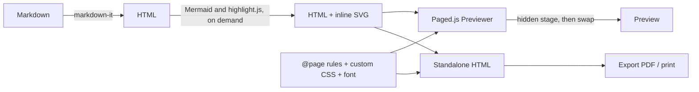

# How it works

The pipeline from the Markdown to the pages, the layout of the repository and the workflows that test, deploy and release it. The rules of the code base are in [CONTRIBUTING.md](../CONTRIBUTING.md) and, in more detail, in [CLAUDE.md](../CLAUDE.md).

## Rendering pipeline



- `documentHtml()` renders the Markdown (images resolved by file name, heading anchors, table of contents), replaces every Mermaid placeholder with its SVG and highlights the code blocks.
- `documentCss()` builds the `@page` rules (size, margins, margin boxes for header, footer and counter), the cover template, the built-in styles, and appends your CSS.
- The subsets of the font that the text needs are loaded before pagination, so the pages are measured with the final font, and inlined in the exports.
- Page numbers of the table of contents and the running header are resolved by Paged.js while it lays out the pages.
- Each render paginates into a hidden container and swaps the pages into the preview in one step, so typing never flashes an empty preview, and a newer edit cancels the previous pagination for good (Paged.js would resume a merely stopped one). A render that produces the same HTML and CSS as the pages shown keeps them.
- Formulas, diagrams and code colours are applied in one pass over an inert fragment of the rendered HTML, the coloured code blocks are cached, and Paged.js, Mermaid, KaTeX, highlight.js and Prettier are loaded on demand.
- The export inlines the exact Paged.js build used by the preview, so both always match.

## Project layout

```
index.html          entry point and the studio markup
vite.config.js      build-time constants: version and commit shown in the sidebar footer
src/main.js         wires the modules: restore, UI, view, first render
src/config.js       defaults (built-in and local/), state, validation, autosave
src/prettify.js     the Prettify button: Prettier's Markdown formatter, loaded on demand, formula blocks and front matter kept out of its way
src/markdown.js     markdown-it rules: images, anchors, table of contents, page breaks, formulas, alerts, numbering; Mermaid, highlighting
src/diagram-labels.js HTML tags in Mermaid labels: bold and italic kept, the other tags dropped
src/crossref.js     labels, references and numbering (pure helpers)
src/math-core.js    formulas: KaTeX output and the font faces a document needs (pure helpers)
src/math.js         KaTeX, its stylesheet and its fonts, loaded on demand
src/images.js       image library: matching by file name, storage, upload; logo storage
src/files.js        the files of a document: assembly, line mapping, safe names (pure helpers)
src/chapters.js     the tabs of the files above the editor
src/editor.js       the CodeMirror editor: one state per file, edits that keep the undo history
src/sync.js         scroll synchronisation between the editor and the preview
src/i18n.js         interface language: French translations, applied to the markup
src/theme.js        light or dark theme of the studio
src/fonts.js        bundled document font: loaded for the preview, inlined in exports
src/font-faces.js   which font subsets a text needs (pure helpers)
src/resize-controls.js resize controls on the diagrams and images of the preview
src/document.js     document CSS (page rules, cover templates, code themes) and HTML, standalone export
src/render.js       Paged.js preview lifecycle, undo history of the preview
src/view.js         workspace: Edit, Split or View, splitter, layout and zoom of the preview, sidebar
src/ui.js           form, tabs, files, images, links of the preview, export and print, banner and toast
src/pdf-capability.js can this browser draw the pages of a PDF
src/pdf-render.js   the PDF drawn by the browser: page images, text layer, links
src/pdf-sources.js  the sources of the document as PDF attachments: attach, read back
src/markdown-sources.js the Markdown export with its YAML front matter, read back on import
src/archive.js      the zip of Markdown files, written and read
src/glyphless-font.js the invisible font of the PDF text layer (Tesseract, Apache 2.0)
src/automation.js   headless API used by the MCP server and the tests
src/version.js      version and commit of the running build
src/escape.js       escaping of text placed in HTML and in CSS strings
src/ui.css          studio chrome (sidebar, toolbar, editor, preview frame)
src/assets/logo.svg logo and favicon
electron/           Electron main process, sandboxed preload and app icon
electron-builder.yml packaging targets: Windows portable exe and zip, Linux AppImage, macOS dmg and zip
mcp/                MCP server (stdio) rendering reports headlessly through dist/
Dockerfile          two-stage image: Vite build, then nginx serving dist/ (docker/nginx.conf); compose.yaml serves it on port 8080
local/              personal defaults, gitignored (local/README.md)
docs/screenshots/   images used in this README, taken by scripts/screenshots.mjs
scripts/            release notes from the changelog, README screenshots, Markdown conformance, repository scan for Understand Anything
docs/writing.md     the writing guide; docs/exports.md saving, exports and reopening; docs/architecture.md this page
docs/markdown-support.md supported Markdown, deliberate differences, measured conformance
docs/css-contract.md the CSS contract of the document, included in the README and served by the MCP server
tests/              web (studio-*.spec.js), desktop, MCP and unit tests
.github/            workflows, Dependabot, issue forms and pull request template
```

The rendered document is styled only by the CSS generated in `documentCss()`, never by `src/ui.css`. The integration tests in `tests/studio-*.spec.js` (one file per domain, shared helpers in `tests/helpers/studio.mjs`) drive the real studio in a headless Chromium, since Paged.js needs a browser to lay out pages: the document and its exports, the layout of the studio, diagrams, images, editing and undo, the document features and the interface language. If port 5173 is busy, `PORT=5183 npm test` uses another one. Run `npx playwright install chromium --only-shell` once before `npm test`.

## Workflows

GitHub Actions workflows in `.github/workflows/`: `ci.yml` runs on every push to `main` and every pull request (lint, Prettier check, the unit, web, desktop and MCP test suites, the Vite build, a Docker build with a smoke test of the container, then the web suite again under Firefox and WebKit); `release-desktop.yml` builds and publishes the desktop binaries on `v*` tags or on demand, once the same checks have passed on that commit (it waits for the CI run of the commit and only runs the checks itself when there is none), with release notes taken from `CHANGELOG.md`; `pages.yml` deploys the web app to GitHub Pages once `ci.yml` has passed on `main`. A commit that fails the tests is neither deployed nor released. Dependabot keeps npm packages and the actions up to date.
