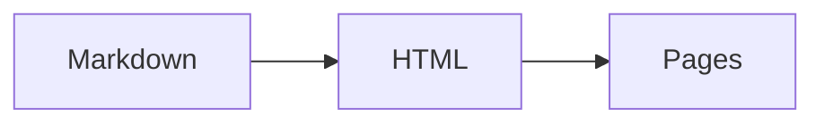
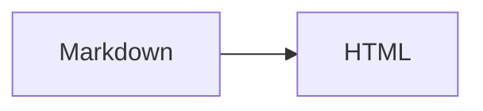
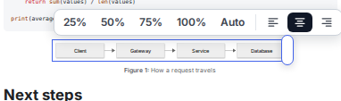
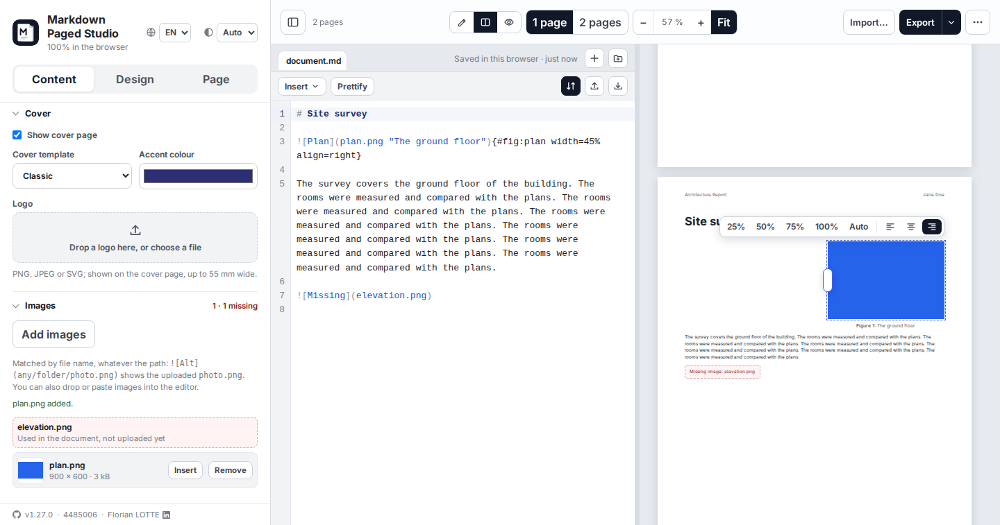
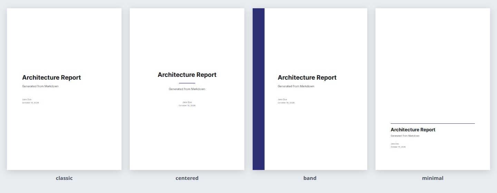

# Writing a document

What you can write in the editor of Markdown Paged Studio, and how the pages come out. The studio itself (preview controls, theme, exports) is described in the [README](../README.md) and in [Saving and exporting](exports.md).

## Writing

The Markdown editor sits in the main area, beside the paged preview (**Split**) or alone (**Edit**); **View** shows the preview alone. It colours the Markdown, numbers the lines and searches or replaces with Ctrl+F. A double-click on a block of the preview puts the cursor on its source line. A document without text says what to do over its pages, and its button takes you to the editor.

The bar above the editor:

- opens the outline (the first button, or Ctrl+Shift+O): the headings of every file, with their numbers when the document numbers them, and a filter above (every word typed must appear, accents and case ignored; Escape clears it, then closes the outline). A click puts the cursor on the heading, and the heading that holds the cursor is marked; with several files the tooltip of a heading names its file. The arrows move between the headings, Enter chooses one;
- inserts a table, an image, a diagram, a formula, an alert, a footnote, a page break or a table of contents at the cursor (the **Insert** menu);
- **Prettify** formats the current file the way [Prettier](https://prettier.io) writes Markdown: one space after `#`, `-` lists, `_emphasis_`, aligned tables, one blank line between blocks; the syntax of the studio is kept, and Ctrl+Z reverts it;
- replaces the current file with an existing `.md` file, or downloads it (named after the title, like the PDF, when it is the only file);
- switches the scroll synchronisation: while it is on, the pane you scroll takes the other one to the same part of the document.

The sidebar holds the settings in groups that fold: the **Content** tab the document fields (with a date picker and the language by name), the cover and its logo, and the images; the **Design** tab the headers and footers, the numbering, the code theme and the stylesheet, in a code editor of its own (line numbers, colours, Ctrl+Z); the **Page** tab the paper size and the margins, with presets.

When the pages differ from what was written, the toolbar counts the problems next to the page count: a diagram Mermaid cannot draw (with the line of its syntax error), a formula KaTeX refuses, an image the library does not have, a reference to nothing. Each entry of the list leads to the line in the editor; the count goes away once the document is fixed.

The parser is [markdown-it](https://github.com/markdown-it/markdown-it): all of [CommonMark](https://commonmark.org) and of GitHub Flavored Markdown (tables, strikethrough, task lists, automatic links), plus footnotes and typographic replacements. Raw HTML inside Markdown is intentionally shown as text. [Markdown support](markdown-support.md) lists what is understood, the four deliberate differences with the specification, what is not supported (abbreviations, emoji shortcodes), and the conformance measured on the official examples.

Whatever the studio writes into the editor for you (the Insert menu, a pasted image, a size set from the preview) is an ordinary edit: Ctrl+Z undoes it like something you typed, and Ctrl+Y or Ctrl+Shift+Z redoes it.

## Several files

A document can be written as several Markdown files, one tab each above the editor, in the order of the document. The preview, the table of contents, the page numbers and every export work on the files put one after the other, with one empty line between them; the settings, the stylesheet and the images are shared. Write `\newpage` at the top of a file to start it on a new page.

| Action             | How                                                                                                |
| ------------------ | -------------------------------------------------------------------------------------------------- |
| New empty file     | **+** at the end of the tabs                                                                       |
| Add existing files | The folder button next to it: pick one or several `.md` files, each becomes a file of its own name |
| Rename             | Double-click the tab, or F2                                                                        |
| Move               | Drag the tab, or Alt + Left / Right                                                                |
| Remove             | The **×** of the tab, or Delete; the toast offers **Undo** for ten seconds                         |
| Switch             | Click, or Left / Right, Home, End on the tabs; Enter goes to the editor                            |

Each file keeps its own undo history and its place in the editor. A change made from the preview goes to the file that holds the source, shown or not. Footnote labels and link references are shared by the whole document: give them different names in different files.

## Diagrams

Any fenced code block tagged `mermaid` becomes an inline SVG:

````markdown

````

To size a diagram, add attributes after the language on the opening line:

````markdown

````

| Attribute | Values                             | Effect                                                               |
| --------- | ---------------------------------- | -------------------------------------------------------------------- |
| `width`   | `10%` to `100%`, or a size in `mm` | Width as a share of the text column, or absolute; the height follows |
| `align`   | `left`, `center`, `right`          | Horizontal position, centered by default                             |
| `caption` | text, in double quotes             | Caption shown under the diagram: `caption="The flow"`                |
| `#fig:…`  | a name, as in `#fig:flow`          | Label of the figure: numbers it and lets `@fig:flow` refer to it     |
| `font`    | a whole number of px, `8` to `40`  | Text size of this diagram, instead of the one set for the document   |

You rarely need to type the size and the alignment: hover or click a diagram in the preview to get size presets (25, 50, 75, 100 %, natural size), alignment buttons and a handle to drag, which also answers to the arrow keys in 5 % steps. A clicked diagram keeps its tools open, also on touch screens, until you click elsewhere or press Escape, so several adjustments can follow one another.

Every change is written back to that opening line, so the size travels with the Markdown into exports, the desktop app and the MCP server. Ctrl+Z undoes it, in the editor or straight from the preview (also in View mode, when the editor is hidden). Without attributes a diagram keeps its natural size, and it is never taller than the text area of a page.

A diagram wider than the text column is scaled down to fit, and its text with it: a dozen boxes in a row can end up unreadable. The **Diagrams** group of the **Design** tab holds the settings that keep them legible, for every diagram of the document: the **text size** Mermaid draws with (16 px by default; the boxes grow with it, the arrows and the space between them do not, so the labels gain a little in a wide diagram and everything in a narrow one), the **spacing** between the boxes (**Compact** tightens the ranks and lets short labels have narrow boxes, **Spacious** airs a small diagram), the **colours** (Mermaid's `neutral`, `default`, `forest` and `dark` themes) and the **line width** of the arrows and links (1 px by default, thin once scaled down). `font=20` on a fence line sets the text size of one diagram only. These settings are part of the project, like the margins, and the MCP server takes them in its `config`.

Every diagram type supported by [Mermaid](https://mermaid.js.org) works. Diagrams are rendered before pagination, so Paged.js knows their exact size, and the resulting SVG is part of the exported file. Labels are drawn as SVG text: `<br>` breaks a line, `<b>`, `<strong>`, `<i>` and `<em>` format the text, and any other HTML tag is removed while its text stays; Mermaid's own Markdown strings (`A["`**bold**`"]`) work too. A diagram with a syntax error shows its error message and source in place, without breaking the rest of the document. Mermaid is loaded on demand the first time a document contains a diagram.



## Formulas, alerts and more

| Write                                   | To get                                                                                |
| --------------------------------------- | ------------------------------------------------------------------------------------- |
| `$E = mc^2$`                            | A formula inside the sentence, written in TeX and drawn by [KaTeX](https://katex.org) |
| `$$` … `$$` on their own lines          | A formula on a line of its own; a ` ```math ` block does the same                     |
| `\begin{equation} … \end{equation}`     | A numbered formula                                                                    |
| `> [!NOTE]` then the lines of the quote | A titled box; also `[!TIP]`, `[!IMPORTANT]`, `[!WARNING]`, `[!CAUTION]`               |
| `==text==`                              | Highlighted text                                                                      |
| `H~2~O`, `x^2^`                         | Subscript and superscript                                                             |
| `Term` then a line starting with `: `   | A definition list                                                                     |

KaTeX, its stylesheet and its fonts are only loaded when a document holds a formula, and the fonts a document uses travel inside its exports. Amounts of money are not formulas (`5 $ and 10 $`, `$5-$10`), and `\$` is always a plain dollar. The title of an alert follows the document language. Details and limits are in [Markdown support](markdown-support.md#formulas-alerts-and-more).

## Numbering and cross-references

Give an element a label and refer to it by that label: the studio writes the numbers, and keeps them right when the document changes.

| Element | Label                                                            | Reference      | Shown as     |
| ------- | ---------------------------------------------------------------- | -------------- | ------------ |
| Image   | `{#fig:plan}`                | `@fig:plan`    | figure 1     |
| Diagram | ` ```mermaid #fig:flow caption="The flow" `                      | `@fig:flow`    | figure 2     |
| Table   | a paragraph `Table: Costs per year {#tab:costs}` after the table | `@tab:costs`   | table 1      |
| Formula | `$$ E = mc^2 $$ {#eq:energy}`                                    | `@eq:energy`   | equation (1) |
| Heading | `## Details {#sec:details}`                                      | `@sec:details` | section 1.2  |

- A reference is a link to its target. `@Fig:plan` starts a sentence with a capital, `-@fig:plan` gives the number alone ("figures 1 and -@fig:flow"). A label that does not exist shows in red, as written.
- A labelled element is always numbered. The **Design** tab can also number every captioned figure and table (**Number figures and tables**) and the headings (**Heading numbering**: from level 1, or from level 2 when level 1 is the title of the document). A heading ending with `{-}` keeps no number. The number of a heading ends with a dot ("1.", "1.1.") and stands half an em from the title (`.heading-number { margin-right: .5em }`, yours to override in the custom CSS).
- The caption of a table is a paragraph starting with `Table:` (or just `:`) right after the table, or right before it; it works without a label too. Write `Table\:` to keep such a paragraph as text.
- A formula on several lines takes its label after the closing dollars (`$$ {#eq:energy}`), a `math` block on its opening line (` ```math #eq:energy `). `align` numbers each row; a `\tag{A}` you wrote is kept.
- `{#details}` at the end of a heading sets its anchor: `[see](#details)` and `@sec:details` both lead to it. Without numbering, a reference to a heading shows its title.
- The words follow the document language ("Figure 1 – " and "tableau 2" in French). A number you typed by hand in a caption is left as it is: remove it when you label the figure.

## Structure: table of contents, page breaks, footnotes, code

| Write                           | To get                                                                                                 |
| ------------------------------- | ------------------------------------------------------------------------------------------------------ |
| `[[toc]]` alone on a line       | The table of contents of the headings that follow it (levels 1 to 3), with their page numbers          |
| `[[toc depth=2]]`               | The same, down to the given level (1 to 6)                                                             |
| `\newpage` alone on a line      | A page break                                                                                           |
| `Text[^1]` and `[^1]: The note` | A footnote, numbered and printed at the foot of the page that calls it; `^[a note]` writes it in place |
| `- [ ] to do`, `- [x] done`     | A task list with check boxes                                                                           |
| ` ```js ` … ` ``` `             | A code block highlighted for its language (about 35 common languages); unknown ones stay plain         |

The **Insert** menu above the editor writes the markers at the cursor (with examples of a table, an image, a diagram, a formula, an alert and a footnote). The table lists what comes after it: a heading placed above it, such as "Contents", is not part of it. Clicking an entry in the preview scrolls to its page.

Every heading gets an anchor named after its text, the way GitHub does: `[see the details](#details)` links to the heading "Details", in the preview and in the exports. Two headings with the same text are told apart with a number (`#details-2`).

The theme of the code blocks (light, dark or none) is chosen in the **Design** tab. The highlighter is loaded on demand, the first time a document contains a code block with a language.

## Images

Add the images of your document with **Add images** in the Content tab, by dropping files on the editor, or by pasting from the clipboard. They are matched to the Markdown **by file name only**, whatever the path and the letter case:

```markdown


```

All three show the uploaded `plan.png`. An existing Markdown file therefore works as it is: import it, then upload its images. Images that the document uses but that are not uploaded yet are listed in the Images section and shown as a "Missing image" box in the page. Uploading a file with the same name replaces the image.

Size and align an image with attributes in braces right after it, or with the same preview tools as the diagrams (hover or click the image):

```markdown
{width=70% align=center}
```

`width` is a share of the text column (`10%` to `100%`, the cell in a table) or a size in `mm`. `align` places the image, and what it does depends on where the image is written:

| Image             | No `align`      | `align=left`                          | `align=center`                 | `align=right`                          |
| ----------------- | --------------- | ------------------------------------- | ------------------------------ | -------------------------------------- |
| Alone on its line | centered        | on the left                           | centered                       | on the right                           |
| Inside text       | in the sentence | floats left, the text wraps around it | on a line of its own, centered | floats right, the text wraps around it |

An image is inside text as soon as its paragraph holds something else: a sentence, a line of text right below it, another image. Headings, tables, code blocks and diagrams always start below a floating image. Without `width` an image keeps its natural size, never wider than the text column nor taller than the text area of a page.

A caption goes in the title of the image, or in a `caption` attribute like the one of the diagrams:

```markdown

{width=60% caption="The ground floor"}
{#fig:plan width=60%}
```

The last form labels the figure: it is numbered ("Figure 1: The ground floor") and `@fig:plan` refers to it, see [Numbering and cross-references](#numbering-and-cross-references). Every image has the preview tools, wherever it is: in a paragraph, a list, a quote, a table cell or a link.



Good to know:

- Images are stored in the browser (IndexedDB) and travel in the project file (**Export → Project only**), which is then a complete document. **Reset the document** (⋯ menu) removes them, unless undone from its toast.
- A raster image wider than 2400 px is scaled down to that width on upload (300 dpi across an A4 text column); SVG and GIF files are never modified.
- Remote images (`https://…`) are left to the browser: they need the network, also in an exported file.
- Two images with the same file name in different folders cannot be told apart: rename one of them.

## Cover page, header and footer



- **Content** tab: title, subtitle, author, date, the cover page toggle, the logo (any image; wider than 1200 px it is scaled down), and the cover template (classic, centered, colour band, minimal) with its accent colour. The templates arrange the same content, so a stylesheet written for one works with the others.
- **Design** tab: header title (top left), header name (top right) and footer text (bottom left). The page counter always sits at the bottom right. With **Use the current heading as header title**, the header shows the heading the page belongs to instead of the header title: the chapter (level 1), or, with **Running header level** set to level 2 or 3, the current section, going back to the chapter title on the page where a chapter starts.

## Page setup

The **Page** tab selects the paper size and the four margins in millimetres (Narrow, Normal and Wide presets, or the same value on all sides). The document language is chosen by name in the **Content** tab, or typed as a BCP 47 tag (`pt-BR`, `zh-Hant`…) under "Other…". The language sets `lang` on the rendered document and on the exported file, which drives hyphenation (`hyphens: auto` in the sample CSS), the typographic quotes produced by the Markdown parser (« » in French, „ “ in German…), the titles of the alerts and the words of the numbering (Figure, Tableau, Abbildung…). The cover page ignores margins and headers.

**Mirror margins on facing pages** swaps the left and right margins on left-hand pages, for double-sided printing: the left margin is then the inner one, the page number stays on the outer edge, and the two-page view of the preview pairs the pages as in the bound document.
